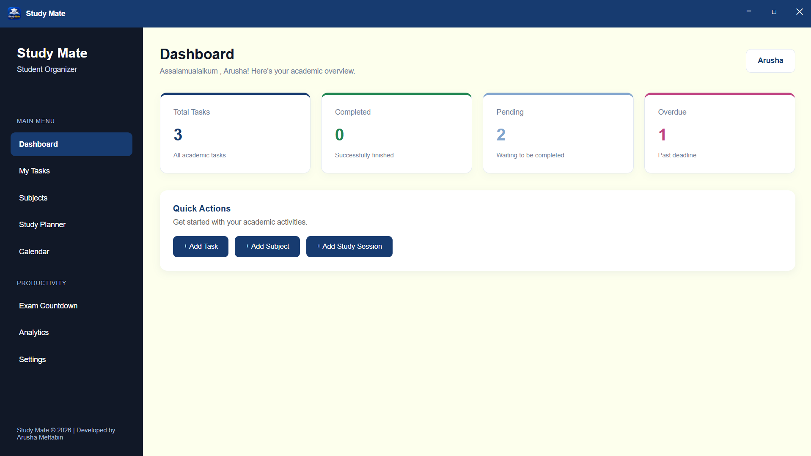
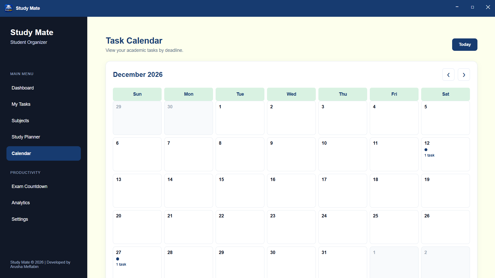
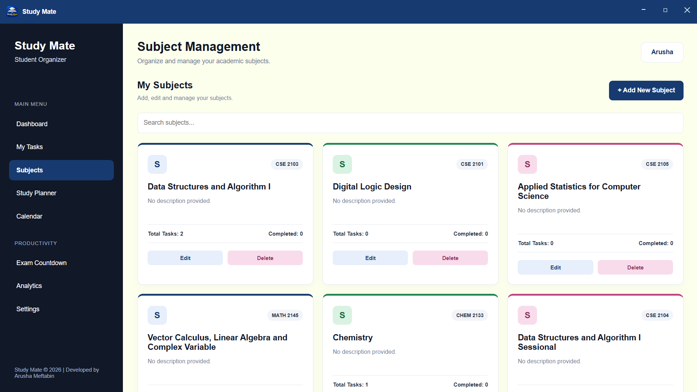

# Study Mate – Student Academic Task Organizer

**A desktop application for managing academic tasks, organizing study schedules, and tracking student productivity.**

---

## 1. Project Overview

Study Mate is a desktop application developed to help students organize their academic activities in one place. It provides tools for managing assignments, projects, study schedules, subjects, and examination dates.

The application is built with Electron.js, HTML, CSS, and JavaScript. It uses local storage to save application data on the user's computer without requiring an external database.

## 2. Project Objectives

- Develop a desktop application for academic task management.
- Organize assignments, projects, and other academic activities.
- Provide a weekly study planning system.
- Track upcoming examinations and academic deadlines.
- Manage tasks according to subjects and priorities.
- Display task progress and productivity information.
- Maintain application data locally on the user's computer.
- Provide a simple and organized user interface.

## 3. Technologies Used

| Technology | Purpose |
|---|---|
| HTML5 | Structures the application interface. |
| CSS3 | Handles layout, styling, and visual design. |
| JavaScript | Implements application functionality and data handling. |
| Electron.js | Runs the application as desktop software. |
| Local Storage | Stores application data locally. |
| Git | Tracks source code changes and project versions. |
| GitHub | Hosts the project source code and repository. |

## 4. System Architecture

Study Mate uses a modular desktop application structure consisting of the following components:

- **User Interface:** Displays the dashboard, navigation, and application features.
- **Application Logic:** Handles task management, subjects, study planning, examinations, and productivity information.
- **Local Storage:** Stores application information on the user's computer.
- **Electron Framework:** Provides the desktop environment and connects the application with the operating system.

## 5. Features

### 5.1 Dashboard
Provides an overview of academic activities and access to the application's main sections.

### 5.2 Academic Task Management
Allows users to create, update, organize, and track academic tasks such as assignments and projects.

### 5.3 Weekly Study Planner
Helps users organize study activities throughout the week.

### 5.4 Priority Management
Allows users to assign priorities to tasks to identify important academic responsibilities.

### 5.5 Subject Management
Provides a way to organize academic tasks according to their subjects.

### 5.6 Exam Countdown
Displays upcoming examination dates and the remaining time before each examination.

### 5.7 Task Calendar
Displays academic tasks and deadlines in a calendar format.

### 5.8 Productivity Analytics
Presents information about task progress and recorded study activities.

### 5.9 Daily Study Tracker
Allows users to record and monitor their daily study sessions.

### 5.10 Overdue Alerts
Identifies tasks that have passed their assigned deadlines.

### 5.11 Backup and Restore
Allows users to back up and restore locally stored application data.

## 6. Project Structure

```text
Student-Academic-Task-Organizer/
│
├── css/
├── js/
├── screenshots/
│   ├── analytics.png
│   ├── calender.png
│   ├── dashboard.png
│   ├── exam countdown.png
│   ├── my task.png
│   ├── study planer.png
│   └── subjects.png
│
├── index.html
├── main.js
├── preload.js
├── icon.ico
├── package.json
├── package-lock.json
├── .gitignore
└── README.md
```

## 7. Application Screenshots

The following screenshots show the main interfaces of Study Mate and its implemented features.

### 7.1 Dashboard



### 7.2 My Tasks


### 7.3 Weekly Study Planner


### 7.4 Exam Countdown


### 7.5 Task Calendar



### 7.6 Subject Management



### 7.7 Productivity Analytics


## 8. Application Development and Distribution

Study Mate is developed using Electron.js and is configured with Electron Builder for application packaging.

The project includes build configurations for the following operating systems:

| Platform | Package Formats |
|---|---|
| Windows | NSIS installer (`.exe`) |
| macOS | DMG (`.dmg`) and ZIP (`.zip`) |
| Linux | AppImage (`.AppImage`) and Debian package (`.deb`) |

GitHub Actions is configured to automate the application build process for the supported platforms.

## 9. Repository

**GitHub:** [Student Academic Task Organizer](https://github.com/Arusha-Meftabin/Student-Academic-Task-Organizer)

