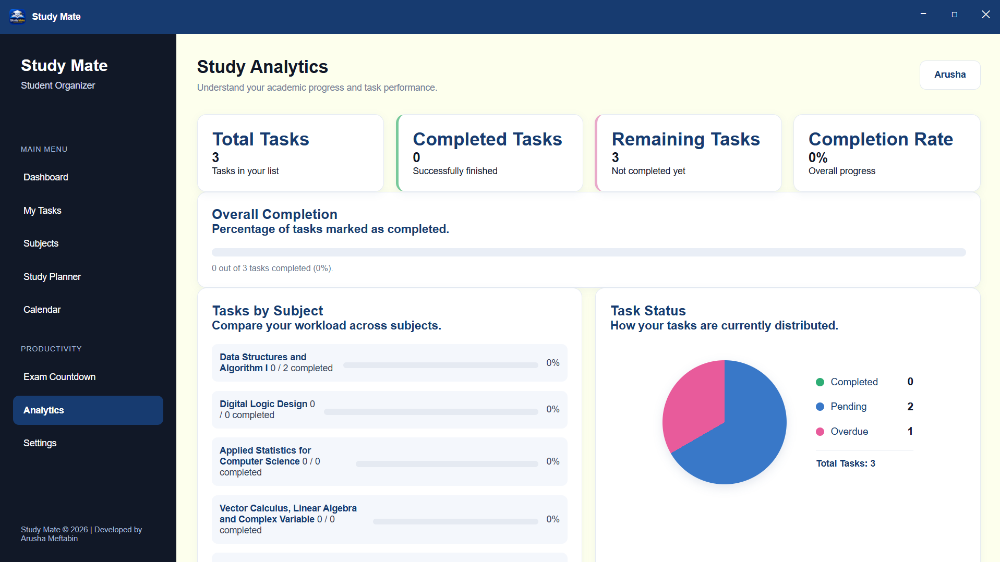

# Study Mate – Student Academic Task Organizer

**A desktop application designed to help students organize academic tasks, plan study activities, manage deadlines, and monitor productivity.**

---

## 1. Abstract

Study Mate is a desktop-based Student Academic Task Organizer developed to make academic planning easier for students. It provides a single platform to manage assignments, projects, study schedules, subjects, and examination dates.

The application is developed using Electron.js, HTML, CSS, and JavaScript. It uses local storage to save information on the user's computer without requiring an external database.

## 2. Introduction

Students often have difficulty managing assignments, examinations, study schedules, and other academic responsibilities. Keeping track of everything manually can lead to missed deadlines and poor time management.

Study Mate aims to solve this problem by providing an organized desktop application where students can manage their academic activities from one place.

The application focuses on simplicity, easy navigation, and local data storage.

## 3. Objectives

- Develop a desktop-based academic task management application.
- Help students organize assignments and other academic activities.
- Provide a weekly study planning system.
- Track examination dates and upcoming deadlines.
- Organize academic tasks by subject and priority.
- Display productivity information and study progress.
- Store user information locally on the computer.

## 4. Methodology

Study Mate is developed using a modular approach. The application interface is created with HTML and CSS, while JavaScript handles application functionality and data management.

Electron.js is used to run the application as a Windows desktop application. Local storage is used to save academic information on the user's computer.

### 4.1 Technologies Used

| Technology | Purpose |
|---|---|
| HTML5 | Application structure |
| CSS3 | Application design and styling |
| JavaScript | Application functionality |
| Electron.js | Desktop application framework |
| Local Storage | Local data storage |
| Git and GitHub | Version control and project hosting |

### 4.2 System Architecture

The application follows a simple desktop architecture:

- **User Interface:** Displays the different pages and features.
- **Application Logic:** Handles tasks, subjects, study plans, examinations, and productivity information.
- **Local Storage:** Saves application data on the user's computer.
- **Electron:** Connects the application with the desktop environment.

## 5. Features

### 5.1 Academic Task Management

Create and manage academic tasks such as assignments, projects, and other study activities.

### 5.2 Weekly Study Planner

Organize study activities and plan learning sessions throughout the week.

### 5.3 Priority Management

Set task priorities to identify important academic responsibilities.

### 5.4 Subject Management

Organize academic tasks according to their subjects.

### 5.5 Exam Countdown

Keep track of upcoming examinations and the remaining days.

### 5.6 Task Calendar

View academic tasks and deadlines in a calendar format.

### 5.7 Productivity Analytics

Review study activity and task progress through productivity information.

### 5.8 Daily Study Tracker

Keep track of daily study activities and study sessions.

### 5.9 Overdue Alerts

Identify tasks that have passed their deadlines.

### 5.10 Backup and Restore

Support backing up and restoring locally stored application information.

## 6. Project Structure

```text
Student-Academic-Task-Organizer/
│
├── css/
│   └── Application stylesheets
│
├── js/
│   └── Application JavaScript files
│
├── screenshots/
│   ├── dashboard.png
│   ├── task-manager.png
│   ├── study-planner.png
│   ├── exam-countdown.png
│   ├── analytics.png
│   └── settings.png
│
├── index.html
├── main.js
├── preload.js
├── icon.ico
├── package.json
├── package-lock.json
├── .gitignore
└── README.md
```

## 7. Results and Visualizations

The following screenshots show the user interface and different sections of the Study Mate application.

### 7.1 Dashboard


### 7.2 Academic Task Manager


### 7.3 Weekly Study Planner


### 7.4 Exam Countdown


### 7.5 Productivity Analytics



### 7.6 Settings


## 8. Discussion

Study Mate provides a centralized solution for managing academic activities. Its desktop-based design allows students to access their planning tools from their computers, while local storage keeps their information on their own devices.

The application brings together task management, study planning, examination tracking, and productivity monitoring in one system.

## 9. Conclusion

Study Mate demonstrates how a desktop application can help students organize their academic responsibilities more effectively. It combines several useful study management features in one simple application.

The project provides an opportunity to apply HTML, CSS, JavaScript, and Electron.js to develop a practical desktop application for students.
